# 👋 Olá! Eu sou o Pedro Costa

Desenvolvedor de Software com experiência em sistemas empresariais, atuando tanto em aplicações desktop quanto em desenvolvimento web.

Atualmente trabalho com manutenção, evolução e implementação de novas funcionalidades em sistemas reais de produção.

<!-- CODE QUEST:START -->
## CODE QUEST

Meu calendário real de contribuições em uma fase original de plataforma 2D.

Cada quadrado representa um dia; as moedas são marcos visuais de atividade.
[Como funciona e como é atualizado](docs/CODE_QUEST.md).
<!-- CODE QUEST:END -->

## 💻 Tecnologias

### Desktop e Banco de Dados
- Delphi / Object Pascal
- Firebird
- SQL

### Web
- JavaScript
- React
- Node.js
- Express
- PostgreSQL

### Ferramentas e práticas
- Git
- GitHub
- APIs REST
- JWT
- Versionamento de código
- Manutenção de sistemas legados
- Desenvolvimento de novas funcionalidades

## 🚀 Experiência

Tenho experiência com sistemas ERP, rotinas financeiras e fiscais, relatórios, banco de dados, integrações e aplicações web.

Grande parte do meu trabalho profissional está em repositórios privados. Por isso, algumas das minhas contribuições aparecem de forma anonimizada no meu perfil do GitHub.

## 📚 Atualmente estudando e evoluindo

- JavaScript
- React
- Node.js
- Arquitetura de Software
- Boas práticas de desenvolvimento
- SQL e modelagem de banco de dados

## 📊 Atividade no GitHub

Uso o GitHub tanto em projetos pessoais quanto em projetos profissionais privados, mantendo histórico de desenvolvimento, versionamento e evolução dos sistemas.

---

### 📫 Contato

- GitHub: @PedroCostinha
