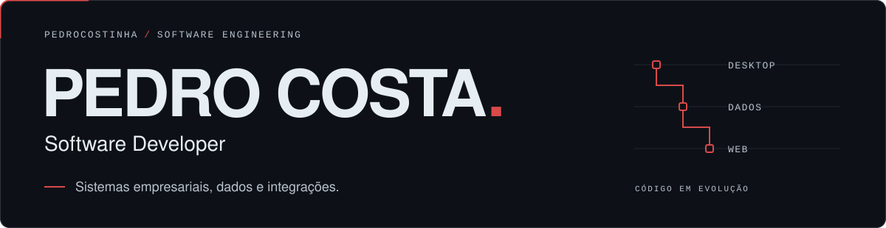

<picture>
  <source media="(max-width: 600px)" srcset="assets/profile/banner-mobile.svg">
  
</picture>

<picture>
  <source media="(prefers-reduced-motion: reduce)" srcset="assets/profile/typing-static.svg">
  
</picture>

## Sobre mim

Desenvolvo sistemas empresariais, aplicações desktop e web. Trabalho com manutenção, evolução e implementação de funcionalidades em software utilizado em produção, conectando interfaces, bancos de dados e integrações.

## Tecnologias

**Desktop** · `Delphi` · `Object Pascal` 
Sistemas empresariais, relatórios e integrações.

**Dados** · `Firebird` · `PostgreSQL` · `SQL`

**Web** · `JavaScript` · `React` · `Node.js` · `Express` · `APIs REST`

**Práticas** · Git e GitHub, versionamento, manutenção de legados e evolução de software.

## Projetos em destaque

### [CODE QUEST · calendário 2D](https://github.com/PedroCostinha/PedroCostinha#code-quest)

Gerador que transforma o calendário real de contribuições em uma fase 2D. Reúne validação de dados, animação vetorial e atualização automática.

`Python` · `SVG / CSS` · `unittest` · `GitHub Actions` 
[Código e documentação](docs/CODE_QUEST.md)

### [CodeDragon](https://github.com/PedroCostinha/codex-codedragon)

Mascote animado com nove estados e dezesseis direções de olhar. Spritesheet transparente, metadados e documentação de validação e importação no Pets do modo Work. Projeto pessoal e independente.

`Animação 2D` · `Spritesheet PNG` · `JSON` · `Documentação`

<!-- CODE QUEST:START -->
## CODE QUEST

Um ano de contribuições transformado em uma pequena aventura 2D.

<a href="assets/code-quest/code-quest.svg">
  <picture>
    <source media="(prefers-reduced-motion: reduce)" srcset="assets/code-quest/code-quest-static.svg">
    
  </picture>
</a>

Cada quadrado representa um dia; as moedas são marcos visuais de atividade. 
[Como funciona e como é atualizado](docs/CODE_QUEST.md)
<!-- CODE QUEST:END -->

## ARCADE COLLECTION

Experimentos de engenharia e pixel art: as animações SVG usam contribuições reais;
o jogo interativo tem pontuação própria da partida.

[**🎮 JOGAR BARREL QUEST**](https://pedrocostinha.github.io/arcade-collection/)

Versão jogável **1.1.0** · [Repositório do jogo](https://github.com/PedroCostinha/arcade-collection)

<strong>Barrel Quest</strong> · animação SVG demonstrativa

Ember-7 sobe cinco andares de uma estação industrial, desvia de barris e entrega
pontos derivados das contribuições. Demonstração automática, sem controles.

<a href="assets/arcade/barrel-quest.svg">
  <picture>
    <source media="(prefers-reduced-motion: reduce)" srcset="assets/arcade/barrel-quest-static.svg">
    
  </picture>
</a>

[Prévia estática e acessível](assets/arcade/barrel-quest-static.svg) · [Arquitetura, auditoria e próximos jogos](docs/ARCADE_COLLECTION.md)

Planejados: **Space Defense** e **Code Snake**, com arte original.
**Pac-Man** está em avaliação de licença e autorização.

## Experiência e foco técnico

Atuo com sistemas ERP, rotinas financeiras e fiscais, relatórios e bancos de dados. Desenvolvo integrações entre aplicações desktop e web e mantenho funcionalidades em produção.

Parte do meu trabalho está em repositórios privados; aqui compartilho projetos pessoais.

---

**Contato** · [@PedroCostinha no GitHub](https://github.com/PedroCostinha)
