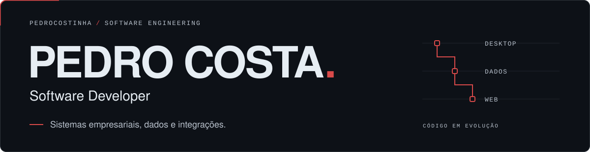

<picture>
  <source media="(max-width: 600px)" srcset="assets/profile/banner-mobile.svg">
  
</picture>

<picture>
  <source media="(prefers-reduced-motion: reduce)" srcset="assets/profile/typing-static.svg">
  
</picture>

Desenvolvo sistemas empresariais e aplicações desktop e web, conectando interfaces, dados e integrações.

## Tecnologias

- **Desktop** · `Delphi` · `Object Pascal`
- **Dados** · `Firebird` · `PostgreSQL` · `SQL`
- **Web** · `JavaScript` · `React` · `Node.js` · `Express` · `APIs REST`
- **Práticas** · `Git / GitHub` · manutenção de legados · evolução de software

## Projetos em destaque

[CODE QUEST V2](#code-quest) · [ARCADE COLLECTION 1.3.0](#arcade-collection) · [CodeDragon](#codedragon)

<!-- CODE QUEST:START -->
## CODE QUEST

Um ano de contribuições transformado em uma pequena aventura 2D.

<a href="assets/code-quest/code-quest.svg">
  <picture>
    <source media="(prefers-reduced-motion: reduce)" srcset="assets/code-quest/code-quest-static.svg">
    
  </picture>
</a>

Cada quadrado representa um dia; as moedas são marcos visuais de atividade. 
[Como funciona e como é atualizado](docs/CODE_QUEST.md)
<!-- CODE QUEST:END -->

`Python` · `SVG / CSS` · `unittest` · `GitHub Actions`

## ARCADE COLLECTION

**1.3.0** · Dois jogos originais em pixel art para jogar no navegador.

**[🎮 EXPLORAR ARCADE COLLECTION](https://pedrocostinha.github.io/arcade-collection/collection/)**

### Barrel Quest

[🎮 Jogar Barrel Quest · 1.1.0](https://pedrocostinha.github.io/arcade-collection/)

Ver animação de Barrel Quest

<picture>
  <source media="(prefers-reduced-motion: reduce)" srcset="assets/arcade/barrel-quest-static.svg">
  
</picture>

[Barrel estático](assets/arcade/barrel-quest-static.svg)

### Code Snake

[🎮 JOGAR CODE SNAKE](https://pedrocostinha.github.io/arcade-collection/code-snake/)

Ver animação de Code Snake

<picture>
  <source media="(prefers-reduced-motion: reduce) and (max-width: 600px)" srcset="assets/code-snake/code-snake-static-mobile.svg">
  <source media="(prefers-reduced-motion: reduce)" srcset="assets/code-snake/code-snake-static.svg">
  <source media="(max-width: 600px)" srcset="assets/code-snake/code-snake-mobile.svg">
  
</picture>

[Code Snake estático](assets/code-snake/code-snake-static-mobile.svg)

As demos compartilham o calendário real de contribuições; os jogos têm pontuação própria da partida.

[Repositório dos jogos](https://github.com/PedroCostinha/arcade-collection) · [Arquitetura da coleção](docs/ARCADE_COLLECTION.md) · [Proposta Code Snake](docs/CODE_SNAKE_ARCHITECTURE.md)

## CodeDragon

[Mascote animado](https://github.com/PedroCostinha/codex-codedragon) com nove estados e dezesseis direções de olhar, criado para o Pets do modo Work. Projeto pessoal e independente.

`Animação 2D` · `Spritesheet PNG` · `JSON` · `Documentação`

## Experiência

Atuo com sistemas ERP, rotinas financeiras e fiscais, relatórios, integrações e manutenção de software em produção.

Parte do meu trabalho está em repositórios privados; aqui compartilho projetos pessoais.

**Contato** · [@PedroCostinha no GitHub](https://github.com/PedroCostinha)
