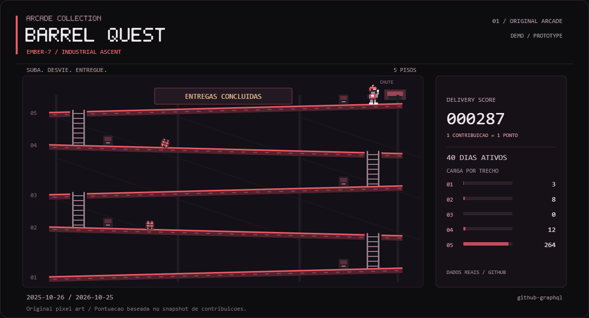
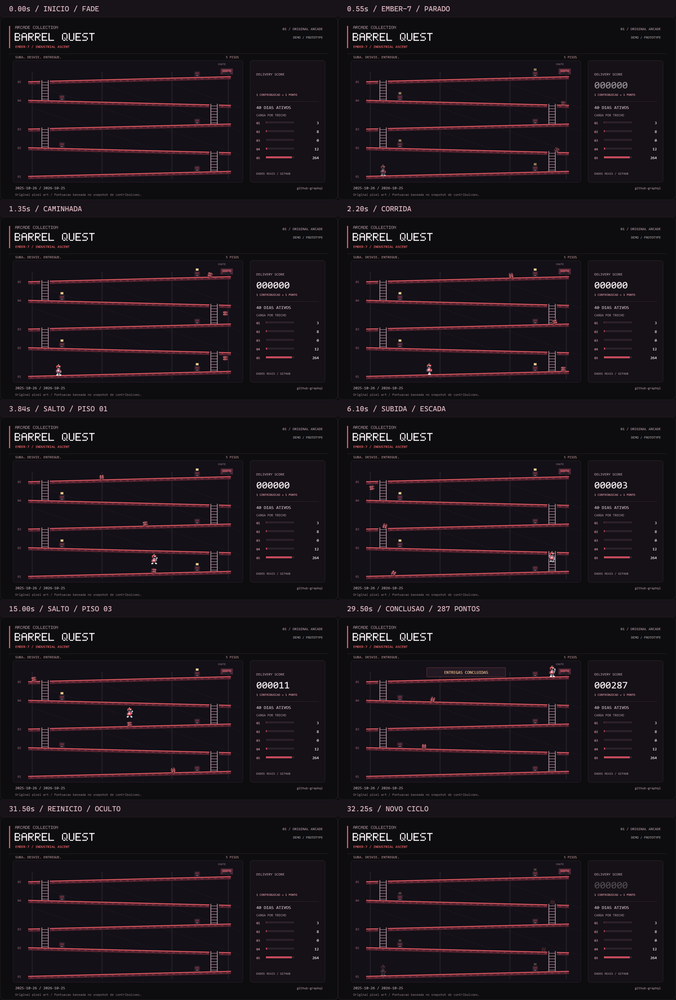
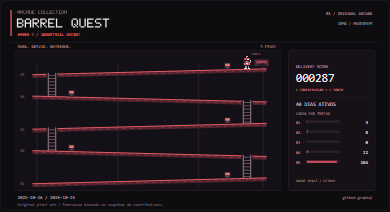

# Barrel Quest — revisão final do protótipo

**Registro histórico da validação do SVG demonstrativo.** A versão interativa
Barrel Quest 1.1.0 foi posteriormente publicada e validada no
[GitHub Pages](https://pedrocostinha.github.io/arcade-collection/), em
[repositório separado](https://github.com/PedroCostinha/arcade-collection).
Seu estado atual está em [ARCADE_COLLECTION.md](ARCADE_COLLECTION.md).
Os resultados e as pendências abaixo descrevem a revisão original do SVG;
não devem ser interpretados como o estado atual da versão jogável.

Revisão em 26/10/2026 da branch `feat/arcade-barrel-quest`, partindo de
`f7b0490`. Código funcional corrigido em `a92f3ed8f803ef6367b65e86339530bba5bc6b69`;
os commits posteriores desta revisão acrescentam QA e documentação. Base da main:
`062ff0d110b866defea9845f7e35d7b1017ab3c0`. Sem merge, deploy, Pages ou execução
do job de escrita na main. Plano: [ARCADE_COLLECTION.md](ARCADE_COLLECTION.md).

## Correção efetivamente necessária

O aviso de conclusão usava `cinematic` e `complete` no mesmo `<g>`. Ambas as
classes definiam o shorthand CSS `animation`; a regra de conclusão sobrescrevia
o fade. Na captura de 31,50 s, o aviso continuava visível quando robô, barris e
placar já estavam ocultos. Foi separado em dois grupos aninhados, preservando
as duas timelines e toda a arte existente. Os dois SVGs foram regenerados.

O novo teste de regressão falhou antes da correção, identificando as duas
animações concorrentes no mesmo elemento, e passou depois. A QA de navegador
agora mede também a opacidade efetiva do aviso, incluindo seus ancestrais:
**1 em 29,50 s; 0 em 31,50 s e 32,25 s**. Não houve redesenho de cenário,
personagem, plataformas ou HUD.

## Dados utilizados

Snapshot real já publicado pelo CODE QUEST: **26/10/2025–25/10/2026**, origem
`github-graphql`, 365 dias, 53 semanas, 287 contribuições e 40 dias ativos.
Não foi feita nova consulta GraphQL para o protótipo. Esse snapshot não deve
ser confundido com uma consulta ao vivo no instante da visualização.

SHA-256 de `assets/code-quest/calendar.json`:
`2bef04859c746702bdbd6f129a8abaed78e4e4bc555453b79eff032f3cc6259a`.

Os cinco trechos somam **3 + 8 + 0 + 12 + 264 = 287**. O trecho vazio continua
vazio; não recebe contribuições ou pontos artificiais. A rota é demonstrativa,
com autoria própria, e não tenta simular a criação de atividade no GitHub.

## Verificações executadas

Ambiente: Windows, Python **3.12.14**, Node **24.22.1**, Playwright **1.62.1**,
Sharp **0.35.5**, Chrome **155.0.8059.85** e Firefox **153.0** em modo headless.
O Firefox foi instalado no cache de testes pelo Playwright. Geração e testes
Python continuam usando somente a biblioteca padrão; os navegadores e pacotes
de QA não são dependências do workflow de publicação.

| Verificação | Resultado |
| --- | --- |
| `python -m unittest discover -s tests -v` | **43 testes aprovados**; 32 existentes + 11 arcade; 4,615 s após a correção |
| `python scripts/generate_code_quest.py --check` | V2 válida: 365 dias, 53 semanas, 287 contribuições; 220.758 bytes |
| `python scripts/generate_arcade.py --check` | Ambos os SVGs válidos e reproduzíveis do mesmo snapshot |
| SVG animado | 117.214 bytes; viewBox 1200×650; abaixo de 250 kB |
| SVG estático | 51.197 bytes; sem keyframes e sem declarações de animação |
| Geração repetida | `Unchanged`; testes confirmam mtime preservado para conteúdo idêntico |
| Entrada inválida | Falha antes de escrever; artefatos anteriores e calendário preservados |
| Segurança SVG | XML, IDs únicos, referências internas, metadados e cinco trechos validados; scripts, imagens, handlers, estilos inline e recursos externos rejeitados |
| Geometria | Barris seguem declives; cinco encontros e saltos; rota contínua, quatro escadas; 6.401 amostras de colisão do sprite completo com barris e tetos |
| CODE QUEST preservado | Nenhum diff de conteúdo Git em módulos, gerador, testes, documentos e assets; bloco marcado do README comparado integralmente; assets do perfil preservados. Comparação respeita normalização LF/CRLF do Git no Windows |
| `git diff --check` | Sem erros de whitespace |

O script `node scripts/preview_arcade.cjs` verifica dez instantes, poses e
placar únicos, salto/subida, aviso de conclusão, fade e retorno ao primeiro
piso com placar zero. Confere o SVG estático e o animado aberto diretamente,
papel acessível de imagem, descrição com total real e distinção entre pontos
e novos commits. Em movimento reduzido não há animações CSS em execução.

Uma página local serve o `<picture>` real do README. A fonte animada muda de
imagem com o tempo; a estática permanece idêntica. A fonte correta é selecionada
nas duas preferências. Foram verificadas larguras de **320, 390, 768 e 1200 px**,
sem overflow horizontal. Nenhum erro JavaScript na página local.

```sh
node scripts/preview_arcade.cjs
# PowerShell, depois de disponibilizar o Firefox do Playwright:
$env:ARCADE_BROWSER='firefox'
node scripts/preview_arcade.cjs
```

Resultados: [Chrome](arcade/qa.json) e [Firefox](arcade/firefox/qa.json).
Poses, placares e fade coincidiram nos dez instantes. A maior diferença numérica
de posição foi **0,0000123 px**, atribuível à precisão de ponto flutuante; não
houve diferença funcional observada. A rasterização das fontes monospace e
das bordas varia ligeiramente entre os motores. As capturas foram examinadas,
sem sobreposição ou corte dos elementos do jogo.

## Revisão visual





Instantes: **0; 0,55; 1,35; 2,20; 3,84; 6,10; 15; 29,50; 31,50 e 32,25 s**.
As timelines são pausadas somente na página de QA; os SVGs publicados não são
modificados pela captura. A composição apenas redimensiona e adiciona rótulos.
[Mesma sequência no Firefox](arcade/firefox/frames.png).
[Estático desktop Chrome](arcade/desktop-static.png) ·
[Estático desktop Firefox](arcade/firefox/desktop-static.png).



No desktop, espaçamentos, hierarquia do título, pisos, visor e placar permanecem
legíveis. Preto/grafite com rampas e acentos vermelhos preservam a identidade.
No celular, o cenário cabe no contêiner e a descrição em Markdown permanece
legível, mas os rótulos internos pequenos precisam de ampliação. Isso é uma
limitação da redução de uma imagem anual/de arcade, não um layout móvel dedicado.
O link de imagem integral e a alternativa estática continuam disponíveis.

## README na interface real do GitHub

Foi aberta a [árvore do commit de revisão no GitHub](https://github.com/PedroCostinha/PedroCostinha/tree/a92f3ed8f803ef6367b65e86339530bba5bc6b69),
com resposta HTTP 200, em Chrome e Firefox. É a prévia do código da branch;
**não é uma validação do perfil publicado na main**. A referência imutável
registra exatamente quais SVGs foram capturados, mesmo após novos commits de QA.

Nos dois motores: a coleção inicia recolhida, pode ser expandida por teclado,
e as imagens CODE QUEST e Barrel Quest são decodificadas. O `<picture>` e seus
`source` sobreviveram à sanitização do GitHub. A preferência reduzida seleciona
os dois SVGs estáticos corretos; a versão animada do Barrel Quest muda entre
capturas. A imagem estática tem dimensões naturais 1200×650. O layout GitHub
foi medido em 390 px sem overflow horizontal e com os links de ampliação visíveis.

O teste de teclado tenta Enter e, quando necessário, Espaço. Enter não foi
consistente durante a inicialização da página do GitHub; Espaço abriu o
`summary` nas execuções que precisaram dessa alternativa. No controle local
isolado de `<details>`, Enter funcionou. Os JSONs registram a tecla efetiva;
não se atribui esse comportamento ao SVG nem se adiciona JavaScript ao README.
Houve também timeouts intermitentes de navegação/teclado em repetições on-line
no Firefox. Uma rodada completa terminou com sucesso e está registrada no JSON;
as verificações locais do SVG passaram. Essa evidência não garante que a
automação da interface externa do GitHub seja estável em toda execução.

| Evidência | Chrome | Firefox |
| --- | --- | --- |
| README desktop, prévia expandida | [captura](arcade/github/chrome/desktop-readme.png) | [captura](arcade/github/firefox/desktop-readme.png) |
| Fonte estática no GitHub | [captura](arcade/github/chrome/desktop-reduced-motion.png) | [captura](arcade/github/firefox/desktop-reduced-motion.png) |
| GitHub em 390 px | [captura](arcade/github/chrome/mobile-reduced-motion.png) | [captura](arcade/github/firefox/mobile-reduced-motion.png) |
| Resultado e URLs efetivamente selecionadas | [JSON](arcade/github/chrome/qa.json) | [JSON](arcade/github/firefox/qa.json) |

O script reproduzível é `scripts/review_arcade_github.cjs`; a variável
`ARCADE_REVIEW_REF` fixa o SHA publicado e `ARCADE_BROWSER=firefox` troca o motor.
As capturas esperam as imagens responsivas e fontes do GitHub carregarem.
A estabilidade dos pixels da imagem estática é verificada na página local
isolada; a QA do GitHub confere seleção/decodificação do recurso e apresentação,
sem confundir mudanças de layout da página hospedeira com animação do SVG.

## Workflow e falhas

O workflow foi revisto integralmente e não precisou de nova alteração nesta
etapa. O horário continua **08:17 UTC / 05:17 de Brasília**, sem cron ou token
adicional. Primeiro gera CODE QUEST e salva o calendário real; depois Barrel
Quest lê exatamente esse arquivo, sem fetch e sem escrever nele. Os dois
checks e a suíte completa precedem a publicação.

PRs têm testes com `contents: read`, checkout sem credenciais persistidas e
ações fixadas por SHA. O job com `contents: write` só pode rodar na branch
padrão e fora de PR. Publica exclusivamente o JSON e os quatro SVGs previstos,
com commit apenas se houver diff e push normal, sem force. Exceções de rede,
validação, geração ou testes abortam o job antes do commit; nenhum estado parcial
é publicado. Os testes cobrem falha de fetch no CODE QUEST e entrada inválida
no arcade, preservação de artefatos e escrita idempotente. Não foi disparado
workflow de atualização manual para testar o caminho de escrita na main.

## Limites e passos para aprovação

- O protótipo é uma sequência automática de 32 s, com colisões de uma rota
  previamente calculada. Não é um jogo controlável, nem um motor de física
  completo. Pontuação e terminais dependem dos dados; a rota/cenário são fixos.
- Chrome e Firefox foram executados de fato. **Safari não executado**: não há
  macOS/iOS compatível neste ambiente Windows. Não foi feita execução com leitor
  de tela real nem auditoria formal de conformidade WCAG. Nome/descrição, alt,
  fontes estáticas, teclado e movimento reduzido foram verificados nas camadas
  descritas; isso não equivale a aprovar todos os leitores de tela.
- O workflow foi revisado e seus comandos rodaram localmente. Não foi
  disparado job remoto de atualização/publicação, e nenhum token novo foi criado.
- Os PNGs são evidências deste snapshot, não artefatos atualizados pelo cron.
- Não há links de jogar fictícios. O repositório separado e GitHub Pages são
  uma proposta, a implementar após aprovação de escopo e publicação.
- Pac-Man depende de autorização/licença verificável do código e dos recursos;
  não foi incorporado. Space Defense e Code Snake permanecem planejados.

O código funcional está pronto para revisão do protótipo após a correção,
condicionado ao CI do Draft PR. A aprovação visual e o merge continuam com o
responsável. Não foi iniciada a versão jogável nem desenvolvido outro jogo.
